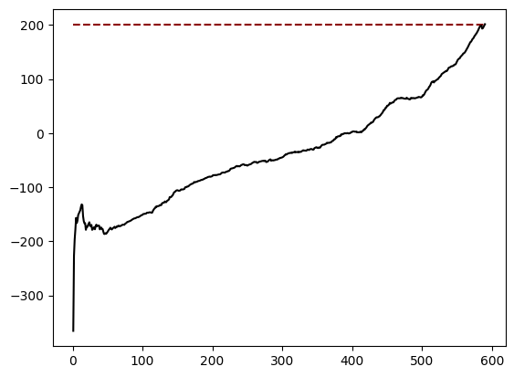

# Deep Q-Learning on CartPole and LunarLander

DQN and Double DQN agents implemented with TensorFlow/Keras, experience replay, target networks, and epsilon-greedy exploration. The project studies learning behavior in Gymnasium's `CartPole-v1` and `LunarLander-v3` environments.

**[Main notebook and historical curves](notebooks/deep_q_learning.ipynb)** · [Research record](docs/research-notes.md) · [Course provenance](docs/course-context.md)

No PDF report or trained checkpoint was supplied. The notebook, its training logs, and its original plots are the research evidence. Despite the folder's inherited name, the environment is **LunarLander**, not a lunar rover simulator.

## Methods

- DQN estimates next-state value with the maximum target-network Q-value.
- Double DQN selects the next action with the online network and evaluates it with the target network.
- Replay memory holds up to 50,000 transitions; discount factor is 0.99.
- CartPole agents use three 256-unit ReLU layers, Adam at 0.00025, MSE loss, batch size 64, and target synchronization every 125 environment steps.
- The generalized LunarLander agent uses two 256-unit ReLU layers, Adam at 0.0006, Huber loss, batch size 128, and synchronization every 250 steps.
- Exploration begins at epsilon 1.0 and decays toward 0.01 over 500 episodes after 30 warm-up episodes for CartPole or 20 for LunarLander.

Training data consists of simulated environment transitions. There is no external dataset to download.

## Historical results

| Agent / environment | Last logged episode | Final running reward | Recorded outcome |
| --- | --- | --- | --- |
| DQN / CartPole | 527 | **223.60** | Reached the project's stopping threshold (>220) |
| Double DQN / CartPole | 460 | **66.06** | Interrupted; no solved result recorded |
| Generalized Double DQN / LunarLander | 590 | **201.60** | Reached the project's stopping threshold (>200) |

Rewards are the original training logs' rounded averages over the latest 100 episodes (or available episodes early in training), not independent evaluation returns. The DQN CartPole run first crossed 200 at episode 521. These single runs do not establish that one algorithm is generally better than another.



The full logs and machine-readable episode tables are in [`results/`](results). The LunarLander log includes status messages inconsistent with the saved source condition; see the [research notes](docs/research-notes.md).

## Run a bounded smoke check

Use a separate Python 3.11/3.12 environment. From this repository:

```bash
python -m venv .venv
# Windows: .venv\Scripts\Activate.ps1
# macOS/Linux: source .venv/bin/activate
python -m pip install -r requirements.txt
python src/smoke_test.py
```

For LunarLander as well:

```bash
python -m pip install -r requirements-lunar.txt
python src/smoke_test.py --lunar
```

The CPU smoke check collects 65 transitions per CartPole agent and 129 for LunarLander, resetting the environment when necessary. Each agent performs **exactly one optimizer update: one minibatch trained for one epoch**. It also checks greedy inference and target-weight synchronization. This verifies execution, not convergence or the historical reward scores.

```bash
jupyter lab notebooks/deep_q_learning.ipynb
```

The notebook defaults to `SMOKE_TEST=True`. Full training requires explicitly setting it to `False`; `MAX_EPISODES` bounds the run, and fresh logs go to `results/rerun/`. The full three-experiment notebook requires the LunarLander dependencies. On Kaggle, upload the repository with its `src/` directory and select an environment satisfying the dependency files. No Kaggle credentials are needed by the code. Full training can take substantial time; saved results can be read without rerunning it.

## Repository and limitations

`src/agents.py` contains the three agent architectures/update rules; `src/experiments.py` contains execution drivers; `notebooks/` contains the research narrative and original figures. `docs/reference/` preserves the supplied lecture examples with their training loops disabled by default.

Historical runs were not seeded and no multi-seed uncertainty analysis or trained weights were supplied. Target networks start independently initialized, matching the original code. Exact historical trajectories cannot be guaranteed. The archived teaching material has no supplied redistribution license; its provenance is documented rather than presented as original research.
